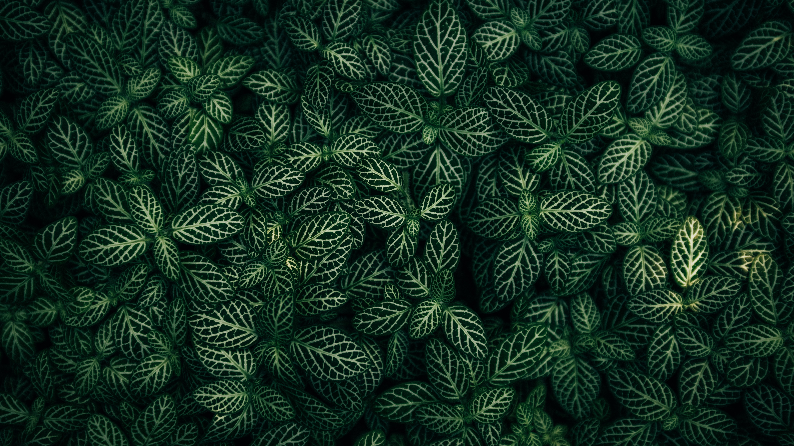

# Chlorophyll — Omarchy Hyprland Theme

A dark, fresh green theme built from the **Chlorophyll** palette. Dark canvas with light green text, vibrant green accents, and calm teal highlights.



## Palette

| Role | Hex |
|------|-----|
| Background | `#010303` |
| Foreground | `#E8E8EA` |
| Accent | `#349071` |
| Selection | `#1a1c1c` |
| Muted | `#5b6362` |
| Darker background | `#010202` |
| Lighter background | `#1a1c1c` |
| Bright cyan | `#92f0a3` |
| Bright green | `#afeb8a` |
| Bright yellow | `#d4ff8b` |
| Cyan | `#92f0a3` |
| Green | `#a2d086` |
| Yellow | `#d6ff9e` |
| Brown | `#656441` |
| Red | `#9a9653` |
| Blue | `#349071` |

## Features

- **Dark mode** — `mode = "dark"` with semantic color variables
- **Wallpapers** — curated wallhaven backgrounds
- **Icons** — icon theme (`icons.theme`)
- **Palette** — all values quoted verbatim from `colors.toml`
- **Hyprland** — designed for Omarchy's Hyprland compositor

## Installation

### Option 1: Install via Omarchy menu (recommended)

1. Open the Omarchy menu (`Super + Space`)
2. Go to **Settings → Themes**
3. Select **Chlorophyll** from the list

### Option 2: Manual install

1. Clone this repository:
   ```bash
   git clone https://github.com/androreturnal/omarchy-chlorophyll-theme.git
   ```

2. Copy the theme files to your Omarchy config:
   ```bash
   cp -r * ~/.config/omarchy/themes/chlorophyll/
   ```

3. Set it as your active theme:
   ```bash
   omarchy theme set chlorophyll
   ```

## Files

- `README.md` — this file
- `colors.toml` — palette source
- `icons.theme` — icon theme
- `preview.jpg` — theme screenshot
- `backgrounds/` — wallhaven wallpapers

## Credits

Palette designed by the Omarchy community. Omarchy is Beautiful, Fun & Agentic Linux by DHH.

## License

MIT
